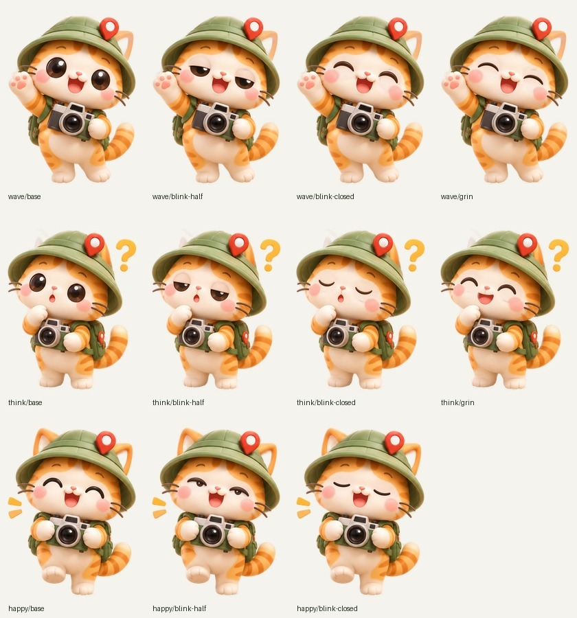
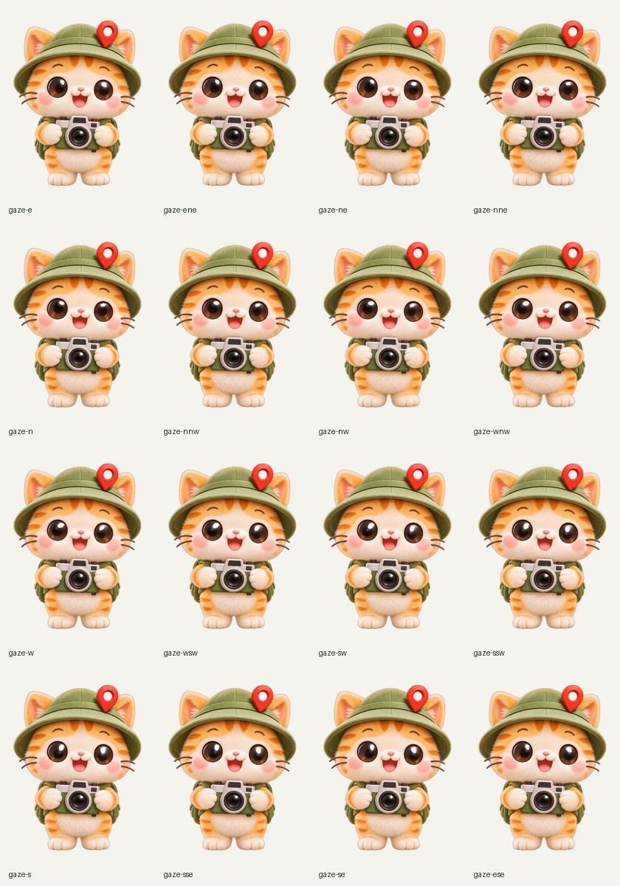
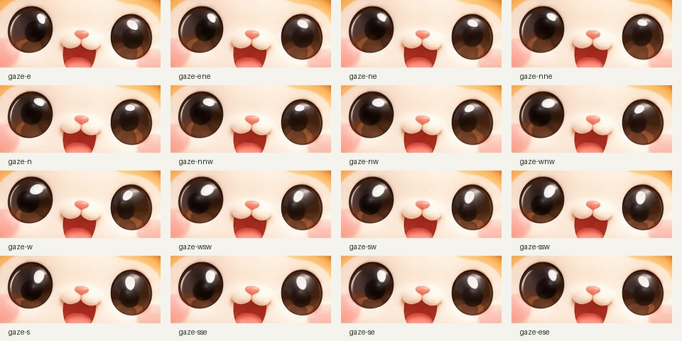
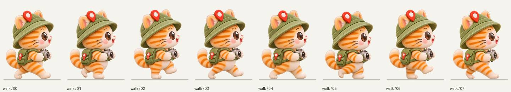
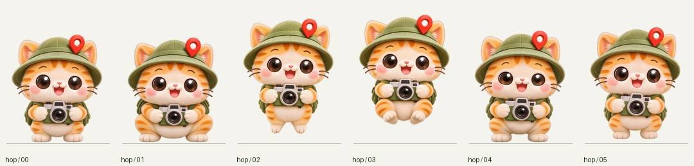
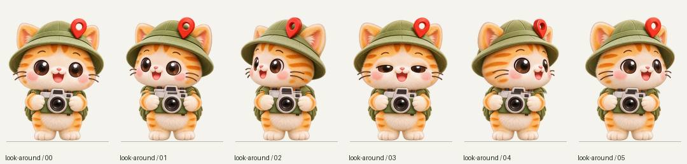
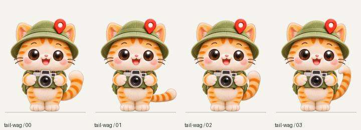
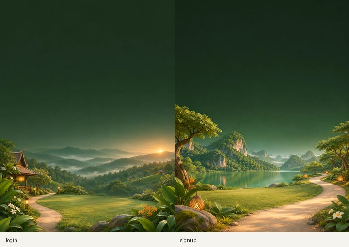

# ชุดสีหน้าน้องทริป

ชุดปัจจุบันใช้ดีไซน์ขนนุ่มฟูที่อนุมัติแล้วครบทั้งภาพหลักใน `apps/web/src/assets/mascot/` และภาพเคลื่อนไหวใน `expressions-v2/` ยังคงเอกลักษณ์แมวส้ม หมวกเขียวพร้อมหมุดแผนที่ กล้อง และเป้ โดยแทนภาพเดิมทั้งชุดเพื่อไม่ให้ขนเปลี่ยนเมื่อกะพริบตาหรือสลับท่า

## ดีไซน์ขนนุ่มฟูและขอบหมวก

ปรับครบ 7 ภาพหลัก: `front`, `wave`, `think`, `happy`, `head`, `side`, `back` รวมภาพหัวที่เมนูใช้ และภาพสำรอง `.webp` จากนั้นประกอบภาพเต็ม 51 ภาพ: front ฐาน 1 + สีหน้า 23 + gaze 16, wave 4, think 4, happy 3 พร้อม face crops และ contact sheets ใหม่ทั้งหมด

ขอบหมวกด้านขวาของ front ถูกเติมให้โค้งครบในภาพต้นฉบับก่อนจัดผืน ไม่ใช่เพียงเพิ่มพื้นที่รอบภาพที่ถูกตัด ภาพ `front.webp` ยังคง 373×520 แต่มีพื้นที่โปร่งใสรอบตัวจริงซ้าย 11, บน 33, ขวา 10, ล่าง 34 px; เมื่อวางใน `front.png` 420×540 ที่ offset (23,20) จะมีขอบ 34,53,34,34 px ตามลำดับ ทุกท่ามีขอบโปร่งใสอย่างน้อย 10 px จึงเห็นหมวก หู หนวด และเท้าครบ

การจัดผืนจากภาพวาดความละเอียดสูงทำครั้งเดียวต่อท่า แล้วใช้ crop/scale/offset เดียวกันกับสีหน้าของท่านั้น บันทึกไว้ใน `assets/mascot/fluffy-manifest.json` พร้อม SHA-256 ของภาพต้นทางและ WebP ที่ส่งจริง ภาพฐาน `.webp` ที่จัดแล้วถูกคัดลอกไป PNG โดยไม่ย่อซ้ำ และแต่ละเฟรมใช้พิกเซลฐานเดิมนอกมาสก์ใบหน้า รวม alpha เดิมทั้งภาพ

```powershell
# สร้างทั้งหมดจากโฟลเดอร์ภาพต้นทางที่อนุมัติ: <pose>-fluffy.png และ <pose>/<expression>.png
python scripts/build_mascot_fluffy.py --inputs-dir path/to/fluffy-inputs

# ตรวจฐาน 7 ภาพ + ทุกสีหน้า + gaze โดยไม่เขียนไฟล์
python scripts/build_mascot_fluffy.py --validate

# ตรวจตัวป้องกันไฟล์/พิกเซลผิดเงื่อนไข
python -m unittest discover -s scripts -p "test_mascot*.py"
```

สคริปต์ตรวจไฟล์ต้นทางให้ครบและไม่ถูกตัดขอบก่อนเริ่ม สร้างผลลัพธ์ในโฟลเดอร์พัก แล้วตรวจ manifest, hash, alpha, pixels, ขนาด และชุดไฟล์ทั้งหมดก่อนนำกลับเข้า assets หากประกอบไม่สำเร็จจะไม่ปล่อยชุดที่ฐานใหม่ปนสีหน้าเก่า ไม่ต้องแก้ runtime JS/JSX เพราะชื่อไฟล์ ขนาดผืน และ offset ที่เว็บใช้อยู่ยังตรงเดิม



## ขนาดและตำแหน่ง

- ภาพเต็มทุกภาพเป็น PNG RGBA พื้นหลังโปร่งใส ขนาด **420 × 540 px**
- `front.webp` จริงในรีโปมีขนาด **373 × 520 px** จึงวางลงบนผืนใหม่ที่ **x=23, y=20** โดยไม่ย่อ/ขยาย ชิดล่างกึ่งกลาง (ระยะขอบซ้าย/ขวาต่างกันหนึ่งพิกเซลเพราะผลต่างความกว้างเป็นเลขคี่)
- `front.png` ในชุดใหม่นี้เป็นภาพอ้างอิงที่จัดผืนแล้ว ให้ใช้ไฟล์นี้เป็นท่าเริ่มเมื่อสลับกับชุดสีหน้า เพื่อป้องกันตัวกระโดดตำแหน่ง
- แถบเดิม `x=60–340, y=140–300` ใช้ช่วงปลายแบบ exclusive: `[60,140,340,300)` เมื่อนำไปวางบนผืนใหม่จึงเป็น `[83,160,363,320)`
- ภาพแถบใบหน้าใน `faces/` มีขนาด **280 × 160 px** และเป็นการตัดจากภาพเต็มโดยตรง
- มาสก์วัดใหม่บนภาพขนฟู คิ้วอยู่ภายในแถบและเปลี่ยนตามอารมณ์ได้; blink, wink, cross-eyed, heart-eyes และ star-eyes ใช้มาสก์ตาเฉพาะเพื่อคงปาก จมูกและคิ้วเดิม

## ตารางไฟล์

ทุกชื่อด้านล่างมีภาพเต็ม `<ชื่อ>.png` และภาพแถบใบหน้า `faces/<ชื่อ>.png` อยู่ในโฟลเดอร์เดียวกัน

| ไฟล์ | สีหน้า | การใช้งานที่เหมาะสม |
| --- | --- | --- |
| `front.png` | ท่าเดิม ตาปกติ | ภาพอ้างอิงและสถานะเริ่มต้น |
| `blink-half.png` | ตาปิดครึ่ง | ช่วงแรก/ท้ายของการกะพริบ |
| `blink-closed.png` | ตาปิด | กลางจังหวะกะพริบ |
| `ouch.png` | ตกใจ / โอ๊ย | ถูกดึงตัว |
| `afraid.png` | ตกใจกลัว | ถูกดึงแรง |
| `squint.png` | หน้าย่น ตาหยี | ดึงแล้วปล่อย |
| `dizzy.png` | มึนหัว ตาหมุน | หมุนหรือสั่น |
| `angry.png` | โกรธ | แตะแรงหลายครั้ง |
| `crying.png` | ร้องไห้ | ปฏิกิริยาเศร้า |
| `grin.png` | ยิ้มกว้าง ตาโค้ง | ดีใจ |
| `shy.png` | หลับตา ยิ้มเขิน | ทักทายอย่างเขิน ๆ |
| `wink-left.png` | ขยิบตาซ้ายของตัวละคร | ตาด้านขวาของผู้ชมปิด |
| `wink-right.png` | ขยิบตาขวาของตัวละคร | ตาด้านซ้ายของผู้ชมปิด |
| `cross-eyed.png` | ตาเหล่ มองจมูก | หยอกเล่น |
| `tongue.png` | แลบลิ้น | หยอกเล่น |
| `kiss.png` | จุ๊บปาก | ปฏิกิริยารักใคร่ |
| `heart-eyes.png` | ตารูปหัวใจ | เมาส์ชี้ปุ่ม |
| `star-eyes.png` | ตารูปดาว | สนใจ/ตื่นเต้น |
| `yawn.png` | หาว | ว่างนาน |
| `pre-sneeze.png` | ก่อนจาม | ก่อนเฟรมจาม |
| `sneeze.png` | ขณะจาม | หลังเฟรมก่อนจาม |
| `whistle.png` | เป่าปาก ผิวปาก | ว่าง/หยอกเล่น |
| `neutral.png` | เฉย ไม่แสดงอารมณ์ | พัก |
| `smirk.png` | แกล้งฉลาด ยิ้มมุมปาก | ปฏิกิริยาขี้เล่น |

รวม **23 สีหน้า + ภาพอ้างอิง 1 ภาพ** และ gaze อีก 16 ทิศตามตารางด้านล่าง

## การประกอบและตรวจสอบ

สร้างภาพแก้สีหน้าด้วยเครื่องมือ ImageGen แบบ built-in โดยใช้ฐานขนฟูความละเอียดสูงที่แก้หมวกแล้วเป็นภาพอ้างอิงทุกครั้ง จากนั้นใช้ crop/scale เดียวกับฐาน ใช้มาสก์ขอบนุ่มภายในแถบที่อนุญาต และประกอบกลับบนพิกเซลฐาน เก็บ alpha เดิมทั้งภาพ จึงไม่พึ่งความแม่นยำของโมเดลสำหรับตำแหน่งตัว หมวก หู มือ หรือกล้อง

คำสั่งตรวจซ้ำ (ต้องมี Python และ Pillow):

```powershell
python scripts/build_mascot_expressions.py --validate
```

ตรวจ RGBA ทุกช่อง รวม RGB ของพิกเซลโปร่งใส โดย `manifest.json` บันทึกผลรายภาพ: จำนวนพิกเซลที่เปลี่ยนนอกแถบต้องเท่ากับ **0**, alpha ต้องเหมือนภาพอ้างอิง, crop ต้องตรงกับภาพเต็มทุกพิกเซล, ขนาดผืนต้องตรง และต้องมีครบ 23 สีหน้า คำสั่งตรวจจะล้มเหลวถ้าข้อใดไม่ผ่าน

ดูรวมทุกภาพได้จาก `contact-sheet.jpg` และอ่านขนาด ตำแหน่ง รายการไฟล์ และ SHA-256 จาก `manifest.json`

สคริปต์ประกอบรับ JSON รูปแบบ `[{"name":"blink-half","path":"path/to/edited.png"}]` ผ่าน `--inputs` เพื่อประกอบสีหน้าที่แก้ใหม่ได้ โดยไม่แตะภาพอื่น ชื่อที่อนุญาตอยู่ใน `LABELS` ของสคริปต์

## การเชื่อมต่อเอนจิน

ชุดนี้เป็นไฟล์ภาพที่ทำเสร็จจริง ไม่ใช่ placeholder สามารถสลับ `src` ของ `` ระหว่างไฟล์เต็มได้โดยไม่ซ้อนภาพ และควรใช้กรอบอัตราส่วน 420/540 คงที่ ภาพแถบใบหน้าเป็นไฟล์ตรวจเทียบ ไม่จำเป็นต้องวางทับในเอนจิน

ยังไม่ได้แก้พฤติกรรมดึงตัว/ตามเมาส์ของเอนจินเดิมหรือผูกครบทุกอารมณ์กับเหตุการณ์ของแอป ทีมสามารถแยก PR เชื่อมเอนจินได้หลังรีวิวภาพโดย Jakkrich และควรปิดการขยับอัตโนมัติเมื่อผู้ใช้ตั้ง `prefers-reduced-motion`

ชุดคำสั่งสร้างภาพอยู่ที่ [NONGTRIP_MASCOT_PROMPTS.md](NONGTRIP_MASCOT_PROMPTS.md)

## สีหน้าบนท่า wave / think / happy

ชุดเพิ่มเติมอยู่ในโฟลเดอร์ย่อย `expressions-v2/wave/`, `think/`, `happy/` และไม่เปลี่ยนไฟล์ท่า front หรือไฟล์ `.webp` ต้นฉบับ โค้ดหน้าเว็บและ `Mascot.jsx` ไม่ได้แก้ในงานนี้ ให้ผู้ดูแลหน้าเว็บเชื่อมการสลับเฟรมเอง

### การเชื่อมเข้าเอนจิน `Mascot`

`components/Mascot.jsx` เลือกชุดภาพตามค่า `mood` จาก `POSE_SETS` ใน `lib/mascot.js` ภาพเริ่มต้นของทุกท่าคือ `base.png` ของท่านั้น (front ใช้ `front.png`) การสลับสีหน้าสลับทั้งภาพผ่าน `src` ของ `` เดียว ไม่ซ้อนหน้า

| ท่า | กะพริบเอง | แตะ / Enter / Space | อื่น ๆ |
| --- | --- | --- | --- |
| front | ครึ่ง → ปิด → ครึ่ง → ปกติ ทุก 3-6 วินาที | ยิ้มกว้าง, 3-4 ครั้งโอ๊ย, 5 ครั้งขึ้นไปโกรธ | ชี้แล้วตาเป็นดาว, ว่างนานหาว |
| wave, think | เหมือน front | ยิ้มกว้าง (`grin`) | |
| happy | ไม่กะพริบเอง (ตาหยียิ้มอยู่แล้ว) | ลืมตามองครู่หนึ่ง (`blink-half`) | |

กรอบของแต่ละท่ามีอัตราส่วนเท่าภาพต้นฉบับ `.webp` ของท่านั้น (front 373:520, wave 400:517, think 400:499, happy 397:517) แล้วดันภาพเต็มให้ล้นกรอบตาม `source_offset` และ `canvas_size` ใน manifest เลย์เอาต์หน้าเว็บจึงเท่าเดิม ตัวเลขชุดนี้อยู่ใน `POSE_SETS` และมีเทสต์เทียบกับ manifest ทุกท่า หากทำภาพชุดใหม่ที่ขนาดผืนต่างไป ต้องแก้ค่าให้ตรง manifest ไม่เช่นนั้นเทสต์จะล้ม

ถ้าผู้ใช้ตั้ง `prefers-reduced-motion` จะไม่กะพริบ/หาวเอง แต่สีหน้าตอบสนองการกดยังทำงาน การเปลี่ยน `mood` ระหว่างที่กำลังกะพริบจะเคลียร์ตัวจับเวลาและสีหน้าชั่วคราวทิ้ง ภาพ `.webp` เดิมยังอยู่เป็นภาพสำรองของ `mood` ที่ไม่รู้จัก

### ผืนภาพและตำแหน่ง

เพิ่มขอบโปร่งใสซ้าย/ขวาข้างละ 10 px และด้านบน 20 px จากขนาดของแต่ละต้นฉบับ โดยไม่ย่อ/ขยายตัวละคร แล้วคัดลอกต้นฉบับลงที่ offset `(10,20)` ขอบล่างเท่าต้นฉบับเดิม แถบใบหน้าทุกค่าเป็น `[x0,y0,x1,y1)` แบบปลาย exclusive

| ท่า | ขนาดต้นฉบับ | ขนาดทุกเฟรม | Offset | แถบบนต้นฉบับ | แถบบนผืนใหม่ | ขนาด crop |
|---|---|---|---|---|---|---|
| wave | 400×517 | 420×537 | (10,20) | [100,112,328,260) | [110,132,338,280) | 228×148 |
| think | 400×499 | 420×519 | (10,20) | [48,126,267,250) | [58,146,277,270) | 219×124 |
| happy | 397×517 | 417×537 | (10,20) | [98,145,312,230) | [108,165,322,250) | 214×85 |

มาสก์ตาถูกวัดแยกตามขนาด/การเอียงศีรษะของแต่ละท่า ไม่ใช้ `BAND_ORIGINAL` หรือ `face_mask` ของ front ส่วน `grin` เพิ่มมาสก์ปากเฉพาะท่าของตัวเอง ทุกมาสก์เก็บอยู่ใน `expression_masks_source` ของ manifest และถูกตัดขอบให้อยู่ภายในแถบใบหน้าเสมอ เฟรม blink เปลี่ยนเฉพาะตา คงปากและจมูกเดิม

### ตารางไฟล์ที่ส่ง

| โฟลเดอร์ | ภาพเต็ม | ความหมาย |
|---|---|---|
| wave/ | base.png | ต้นฉบับ wave จัดบนผืนใหม่ |
| wave/ | blink-half.png | ตาปิดครึ่งทั้งสองข้าง |
| wave/ | blink-closed.png | ตาปิดทั้งสองข้าง ยังคงปากเดิม |
| wave/ | grin.png | ตาหยียิ้มและยิ้มกว้าง สำหรับตอนแตะ |
| think/ | base.png | ต้นฉบับ think จัดบนผืนใหม่ |
| think/ | blink-half.png | ตาปิดครึ่งทั้งสองข้าง |
| think/ | blink-closed.png | ตาปิดทั้งสองข้าง คงปากรูปตัว O |
| think/ | grin.png | ตาหยีและเปลี่ยนเป็นปากยิ้ม สำหรับตอนแตะ |
| happy/ | base.png | ต้นฉบับ happy จัดบนผืนใหม่ |
| happy/ | blink-half.png | ตาปรือเปิดเล็กน้อย |
| happy/ | blink-closed.png | หลับตาผ่อนคลาย เส้นตาต่ำกว่าตาหยียิ้มของ base |

ทุกภาพมี crop ชื่อเดียวกันใน `faces/` พร้อม `manifest.json` และ `contact-sheet.jpg` ประจำโฟลเดอร์ รวม **8 สีหน้าใหม่ + 3 ภาพฐาน** ภาพเต็มทุกไฟล์เป็น PNG RGBA และ alpha เหมือนต้นฉบับที่จัดผืนแล้วทุกพิกเซล

ตรวจแล้วว่า `think.webp` **ตาเปิดทั้งสองข้าง** จึงทำ blink ทั้งสองเฟรมให้ครบ ไม่ได้ใช้ข้อยกเว้น ส่วน `happy.webp` เดิมตาหยียิ้มปิดอยู่แล้ว: `blink-half` เป็นการปรือตาขึ้นเล็กน้อย และ `blink-closed` เป็นการหลับตาแบบผ่อนคลาย จึงไม่ควรถือว่า `base` ของ happy เป็นเฟรมตาเปิดเหมือน wave/think

ต้องสลับทั้งภาพโดยใช้ `base.png` ของท่านั้นคู่กับสีหน้าในโฟลเดอร์เดียวกัน ห้ามเริ่มด้วย `.webp` ขนาดเดิมแล้วเปลี่ยนเป็น PNG ที่ขนาดต่างกัน และห้ามซ้อนภาพแถบใบหน้าบนตัวละคร

### คำสั่งประกอบและตรวจ

```powershell
# ตรวจ front เดิม + wave + think + happy แบบอ่านอย่างเดียว
python scripts/build_mascot_expressions.py --validate

# ตรวจเฉพาะท่า
python scripts/build_mascot_expressions.py --pose wave --validate
python scripts/build_mascot_expressions.py --pose front --validate

# ประกอบท่าใหม่จากภาพแก้สีหน้า (ต้องระบุครบชุดของท่านั้น)
python scripts/build_mascot_expressions.py --pose wave --inputs path/to/wave-inputs.json

# ทดสอบตัวตรวจด้วยสำเนาที่จงใจทำให้ผิดเงื่อนไข
python -m unittest discover -s scripts -p test_mascot_pose_expressions.py
```

รูปแบบ inputs ยังเป็นรายการ `[{"name":"blink-half","path":"path/to/edited-image.png"}, ...]` การประกอบ front ผ่าน `--inputs` เดิมยังใช้ฟังก์ชันเดิม ส่วนการประกอบท่าใหม่อยู่ใน `scripts/mascot_pose_expressions.py`

`--validate` ตรวจว่า base ตรงต้นฉบับที่จัดผืน, PNG RGBA/ขนาดถูกต้อง, ชุดครบ, crop ตรง, alpha ไม่เปลี่ยน และจำนวนพิกเซลที่เปลี่ยนนอกแถบเป็นศูนย์ รวม RGB ของพิกเซลโปร่งใสด้วย พร้อมตรวจ manifest/แฮช/พิกัดและเพดาน 5,000,000 bytes ต่อไฟล์ การตรวจไม่สร้างหรือซ่อมไฟล์ให้อัตโนมัติ และคืน exit code ที่ไม่เป็นศูนย์เมื่อผิดเงื่อนไข

ผลตรวจส่งมอบ: front 23/23, wave 3/3, think 3/3, happy 2/2 ผ่านทั้งหมด (`outside_changed_pixels=0`, alpha/crop/manifest ผ่าน) ชุดทดสอบ 13 ข้อผ่าน ครอบคลุมไฟล์หาย, ขนาดผิด, alpha ผิด, RGB นอกแถบ, crop ผิด, manifest ผิด, ไฟล์เกินขนาด และยืนยันว่าการตรวจไม่เขียนทับชุดภาพเดิม

### แนวทางการสร้างสีหน้า

ใช้ ImageGen แบบ built-in แก้ทีละสีหน้า โดยอ้างอิงภาพฐานขนฟูความละเอียดสูงของท่านั้น จากนั้นประกอบเฉพาะมาสก์ใบหน้ากลับลงบนต้นฉบับด้วย Pillow ภาพระหว่างทางไม่ใช่ไฟล์สำหรับเชื่อมเว็บ และไม่ได้ใช้แทนต้นฉบับเต็มตัว

ข้อกำหนด prompt: ใช้ขนละเอียดนุ่มฟูแบบเดียวกับฐานที่อนุมัติ คงแมวส้ม หมวกเขียวหมุดแดง กล้อง เป้ ท่าทาง มุมศีรษะ ผืนภาพ และพื้นโปร่งใส แก้เฉพาะตาสำหรับ blink-half/blink-closed และตากับปากสำหรับ grin; ห้ามเปลี่ยนตำแหน่งมือ หู หนวดหรือเครื่องหมายคำถาม ใช้กรอบภาพเต็มตามต้นฉบับ ไม่มีข้อความเพิ่ม สคริปต์ประกอบจะใช้ alpha เดิมและพิกเซลเดิมนอกมาสก์เสมอ

ผู้ดูแลหน้าเว็บ: `jirapa-gm` · ผู้รีวิวเมื่อได้รับคำสั่งเปิด PR: `Jakkrich` สามารถแยกรีวิวภาพตามโฟลเดอร์ท่าได้ โดยให้ชุดสคริปต์ตรวจและเอกสารเป็น dependency ร่วม

## เล่นกับมาสคอต (แผ่นยืดได้ WebGL)

ทุกที่ที่ใช้ `<Mascot>` (หน้าแรก, ล็อกอิน, แชต, ค้นหา, ที่พัก ฯลฯ) เล่นด้วยได้ ไม่ต้องเพิ่มโปรปใด ๆ เอนจินเริ่มทำงานเมื่อเมาส์/นิ้วเข้าใกล้ (ตัวใหญ่ตั้งแต่ 150px ขึ้นไปเริ่มเองหลังโหลดเสร็จ) ก่อนหน้านั้นและเมื่อ WebGL ใช้ไม่ได้ จะเป็นภาพนิ่งเดิมทุกอย่าง

กติกาที่ห้ามแตก
- บนจอมีภาพเดียวเสมอ สลับสีหน้าคือเฟดทั้งภาพไม่เกิน 70 ms ไม่วางแพตช์ทับหน้า
- แผ่นห้ามพับทับตัวเอง (untangle ทุกเฟรม) และฟิสิกส์เดินก้าวคงที่ 1/240 วินาที
- ไม่เปลี่ยนสีหน้าเองระหว่างที่ผู้ใช้ขยับอยู่ ท่าเล่นเองเริ่มเมื่อไม่มีการขยับ 30–45 วินาที และผู้ใช้ขยับเมื่อไหร่ก็จบทันที
- `prefers-reduced-motion`: ไม่มีท่าเล่นเอง ไม่ยืด ไม่กะพริบ

| การกระทำ | ผลลัพธ์ |
| --- | --- |
| ชี้ตาซ้าย/ขวา | ขยิบตา (`wink-right` / `wink-left`) |
| ชี้จมูก / ปาก | ตาไขว้ (`cross-eyed`) / จุ๊บ (`kiss`) |
| กดค้างแล้วลาก | ตัวยืดเหมือนแป้ง ยิ่งไกลยิ่ง `ouch` แล้ว `afraid` |
| ปล่อย | สั่นกลับเข้าที่ แล้วสีหน้าตามแรงที่ดึง (`squint`/`dizzy`); ดึงซ้ำ 5 ครั้งโกรธ 8 ครั้งร้องไห้ |
| แตะตามจุด | หมวก `angry`, หมุด `star-eyes`, ตา `ouch`, จมูกจาม, ปาก `tongue`, แก้ม `shy`, หน้า `grin`, กล้อง `smirk`, ท้อง `squint`, เท้า `afraid` |
| แตะรัว ๆ 5 ครั้ง | `angry` |
| เขย่าเคอร์เซอร์ | `squint` แล้ว `dizzy` |
| ชี้ปุ่มที่ติด `data-mascot-cheer` | ตาหัวใจ ออกจากปุ่มแล้วยิ้ม |
| คีย์บอร์ด Enter/Space ที่ตัวมาสคอต | แตะแทนเมาส์ |
| ไม่ขยับ 30–45 วินาที | ท่าเล่นเอง: หาว, ผิวปาก, จาม, หยอก, ตาไขว้, ตกใจ, เศร้า, ผล็อยหลับ, ผีเสื้อบิน, ดึงหนวด |

ท่า wave / think / happy มีสีหน้าไม่ครบ สีหน้าที่ไม่มีจะถอยเป็น `blink-half` (ลบ) หรือ `grin` (บวก)

### มองตามเคอร์เซอร์ (ภาพครบ 16 ทิศ)

ชุดภาพอยู่ที่ `apps/web/src/assets/mascot/expressions-v2/` โค้ดจาก PR #56 ตรวจชื่อ PNG ทั้ง 16 ทิศและเปิด gaze อัตโนมัติเมื่อครบ โดยไม่ต้องแก้ runtime เพิ่ม รายการภาพและผลเทียบพิกเซลบันทึกใน `manifest.json` หัวข้อ `gaze` แยกจาก `expressions` เดิม 23 สีหน้า

| ไฟล์ | ทิศบนจอ | ไฟล์ | ทิศบนจอ |
|---|---|---|---|
| gaze-e.png | ขวา | gaze-w.png | ซ้าย |
| gaze-ene.png | ขวาเฉียงขึ้นเล็กน้อย | gaze-wsw.png | ซ้ายเฉียงลงเล็กน้อย |
| gaze-ne.png | ขวาบน | gaze-sw.png | ซ้ายล่าง |
| gaze-nne.png | บนเฉียงขวาเล็กน้อย | gaze-ssw.png | ล่างเฉียงซ้ายเล็กน้อย |
| gaze-n.png | บน | gaze-s.png | ล่าง |
| gaze-nnw.png | บนเฉียงซ้ายเล็กน้อย | gaze-sse.png | ล่างเฉียงขวาเล็กน้อย |
| gaze-nw.png | ซ้ายบน | gaze-se.png | ขวาล่าง |
| gaze-wnw.png | ซ้ายเฉียงขึ้นเล็กน้อย | gaze-ese.png | ขวาเฉียงลงเล็กน้อย |

ทุกภาพเป็น PNG RGBA **420×540** ใช้พิกเซลจาก `front.png` เท่านั้น แปลงพิกัดเนื้อภาพภายในดวงตาเดิมด้วย Pillow โดยระยะเลื่อนลดลงอย่างราบรื่นจนเป็นศูนย์ที่ขอบตา ไม่สร้างตาหรือประกายใหม่ ไม่มีภาพจากงานอื่น ปากยิ้ม จมูก แก้ม หนวด หมวก หู กล้องและตัว รวมถึงค่า alpha ทุกพิกเซล คงเดิมทั้งหมด

วงรีที่อนุญาตให้เปลี่ยนอยู่ที่ `(cx,cy,rx,ry)` = `(155.5,236,25,26.5)` และ `(280,243.5,23.5,26)` ใช้ระยะเลื่อนสูงสุดแนวนอน 7.5 px และแนวตั้ง 7 px โดยลดน้ำหนักตาม `w=(1-r²)²` จึงคงขอบตาและไม่ทำให้ลูกตาทะลุขอบ มุมเพิ่มครั้งละ 22.5° เริ่มขวาแล้ววนขึ้น รอบสมบูรณ์เชื่อม `ese → e` ด้วยสูตรเดียวกัน ระยะเลื่อนที่ศูนย์ตาระหว่างทิศติดกันมากสุด **2.919168 px**

ผลเทียบกับฐาน: กรอบรวมของพิกเซลที่เปลี่ยนคือ **[131,211,304,270)** แบบปลาย exclusive อยู่ภายในแถบใบหน้าเดิม `[83,160,363,320)` แต่เปลี่ยนจริงเฉพาะภายในวงรีดวงตาสองข้าง จำนวน 3,466–3,526 พิกเซลต่อภาพ; นอกดวงตาเปลี่ยน **0 พิกเซล**, alpha ตรงทุกภาพ ขนาดไฟล์ภาพ 247,308–247,793 bytes ต่อไฟล์

```powershell
# สร้าง 16 ภาพ + manifest.gaze + contact sheets จาก front.png เดิม
python scripts/build_mascot_gaze.py --build

# ตรวจ gaze อย่างเดียว หรือรวมสีหน้าเดิมและทุกท่า
python scripts/build_mascot_gaze.py --validate
python scripts/build_mascot_expressions.py --validate

# ทดสอบตัวตรวจและทิศทางจากรายละเอียดภาพจริง
python -m unittest discover -s scripts -p test_mascot_gaze.py
```

ตัวตรวจ gaze เป็นแบบอ่านอย่างเดียว และล้มเมื่อชื่อไม่ครบ/เกิน, รูปแบบหรือขนาดผิด, alpha เปลี่ยน, มีพิกเซลนอกดวงตาเปลี่ยน, ภาพไม่ตรงทิศที่ระบุ หรือ manifest/แฮชไม่ตรง ตัวตรวจเดิมรวมผล gaze และตัวสร้าง manifest เดิมเก็บข้อมูล gaze ไว้ การตรวจไม่เขียนทับภาพสีหน้า





ไฟล์: `lib/mascotSheet.js` (ฟิสิกส์), `lib/mascotGl.js` (วาด), `lib/mascotPlay.js` (กติกา/โซน/ท่า), `lib/mascotInput.js` (ติดตามการขยับ), `components/MascotSheet.jsx` (เอนจิน)

## น้องทริปเพื่อนคู่ใจ (มาสคอตเดินทุกหน้า + แชตลอย)

`components/ChatCompanion.jsx` แสดงทุกหน้า ยกเว้นหน้าแชตเต็ม (`/chat`) กับหน้าเข้าสู่ระบบ/สมัคร (ยังคงสถานะแชตไว้ ไม่ทิ้งบทสนทนา)

- เดินซ้าย-ขวาตามแนวนอนที่ความสูงเดิม (ตั้งต้นที่ขอบล่างจอ) หยุดพัก เล่นท่าเอง (โบกมือ ผิวปาก ขยิบตา …) หยุดเดินเมื่อชี้ ลาก เปิดแชต หรือซ่อนแท็บ ถ้าผู้ใช้ตั้งลดการเคลื่อนไหวจะไม่เดาเอง
- ลากไปวางที่ไหนของจอก็ได้ ตำแหน่งจำไว้เป็นสัดส่วนของจอใน localStorage (ใช้ไม่ได้ก็กลับไปตั้งต้น) ใช้ลูกศรบนคีย์บอร์ดขยับได้ (Shift = ก้าวใหญ่)
- แตะ/กดเปิดหน้าต่างแชต (Esc หรือปุ่ม × ปิด) ใช้ระบบแชตเดิมผ่าน `lib/useChatSession.js` ชุดเดียวกับหน้า `/chat` จอแคบ (< 560px) เป็นแผ่นเต็มความกว้างติดล่างจอ
- อารมณ์ตามสถานะ (`lib/companion.js` `companionFace`): กำลังค้น → ท่า think, ตอบเสร็จ → ยิ้ม, ผิดพลาด → ร้องไห้, ชี้/พิมพ์ → ตาเป็นดาว, ถูกลาก → ตกใจ มีจุดแดงเมื่อมีคำตอบใหม่ตอนหน้าต่างปิด
- หน้าที่ดูอยู่ส่งบริบทให้แชต (`lib/companionContext.jsx`): หน้าค้นหา/รายละเอียดสถานที่ส่งจุดค้น หน้าจังหวัดส่งชื่อจังหวัด
- ใช้ภาพชุดเดิมทั้งหมด ไม่ต้องมีภาพใหม่

## ภาพเคลื่อนไหวขนนุ่มฟู (motion)

ชุดนี้เป็นภาพสำหรับผู้ดูแลเว็บนำไปเชื่อมต่อ อ้างอิงดีไซน์ขนนุ่มฟูจาก PR #74 และฐาน develop `2f1128b` ไม่มีการแก้โค้ดหน้าเว็บ ภาพเดิม หรือชุดสีหน้า/gaze เดิม

ทุกเฟรมเป็น WebP RGBA โปร่งใส **360×480 px** อยู่ใน `apps/web/src/assets/mascot/motion/` ตั้งชื่อเลขสองหลักเริ่มที่ `00.webp` และเล่นตามลำดับแล้ววนกลับ 00 สลับทั้งภาพในกล่องขนาดคงที่ ห้าม crop ตามขอบตัวของแต่ละเฟรม

| ชุด | ไฟล์ | จำนวน | fps แนะนำ | ลำดับการเคลื่อนไหว |
|---|---|---:|---:|---|
| walk | `walk/00.webp`–`07.webp` | 8 | 10 | เดินมุมข้างหันขวา สลับขารับน้ำหนัก |
| hop | `hop/00.webp`–`05.webp` | 6 | 10 | ย่อเบา → ย่อลึก → ออกตัว → ลอย → ลงพื้น → เด้ง |
| look-around | `look-around/00.webp`–`05.webp` | 6 | 6 | ตรง → ซ้ายเล็กน้อย → ซ้าย → ตรงครึ่งตา → ขวา → ขวาเล็กน้อย |
| tail-wag | `tail-wag/00.webp`–`03.webp` | 4 | 6 | ยืนหน้าตรง หางตั้ง → กางต่ำ → ยก → โค้งสูง |

แต่ละโฟลเดอร์มี `manifest.json` และ `contact-sheet.jpg` โดย manifest ระบุ `canvas_size`, `frame_count`, `fps`, `loop`, `anchor` รวมทั้งรายการเฟรม ขนาดไฟล์ SHA-256 กรอบ alpha และข้อมูลจัดตำแหน่ง

**anchor = [180,447] px** วัดจากมุมซ้ายบนของผืน เป็นจุดพื้นคงที่ ไม่ใช่ตำแหน่งปลายเท้าแต่ละข้างที่ขยับขณะเดิน การขยับตำแหน่งมาสคอตบนหน้าจอให้ทำที่กล่องภายนอก และใช้จุดนี้ยึดทุกเฟรม ท่า hop ใช้จุดพื้นเดิมตามที่ตกลง แต่เท้าลอยได้: ระยะจากพื้นตามลำดับเฟรมคือ **0, 0, 26, 55, 0, 10 px** แล้วกลับลงจุดเดิม ไม่ชดเชยระยะนี้ด้วยการเลื่อนรูปลงอีก

ท่า look-around ใช้ช่วงล่างจากเฟรมฐานร่วมกัน ส่วน tail-wag ใช้ลำตัวเดิมและเปลี่ยนบริเวณหาง การตรวจยืนยัน alpha ของพื้นที่เท้า `[0,420,360,480)` ตรงกันในทุกเฟรมของสองชุดนี้ ส่วน walk/hop ตรวจแกนศีรษะแนวนอนจากภาพที่ถอดรหัสจริงและจุดสัมผัสพื้นตามระยะที่กำหนด

ผลส่งมอบ: **24 เฟรม** ไฟล์ใหญ่สุด **31,890 bytes** (กำหนดไม่เกิน 60,000) โฟลเดอร์ motion รวมภาพ manifest และ contact sheets **849,044 bytes** (กำหนดไม่เกิน 1,200,000) ภาพไม่ชนขอบและเหลือระยะอย่างน้อย 8 px ตัวเลขนี้วัดจากไฟล์ที่ส่งจริง โดยไม่นับพื้นหลังหน้าเข้าสู่ระบบซึ่งแยกโฟลเดอร์

### การตรวจและสร้างไฟล์ motion

ตัวตรวจใช้ Python + Pillow และอ่านอย่างเดียว ไม่ต้องมีภาพต้นทาง:

```powershell
python scripts/validate_mascot_motion.py
python -m unittest discover -s scripts -p test_mascot_motion.py
```

ตัวตรวจล้มเมื่อชุด/จำนวน/ชื่อไฟล์ไม่ครบ รูปแบบหรือขนาดผิด ไม่โปร่งใส ภาพชนขอบ จุดพื้นหรือแกนตัวเลื่อน พื้นที่เท้าของท่ายืนเปลี่ยน เฟรมซ้ำ manifest/แฮชไม่ตรง หรือขนาดไฟล์เกินกำหนด มีเทสต์ 26 ข้อรวมตรวจชุดส่งมอบจริง การตรวจตำแหน่งไม่อาศัยเฉพาะค่าที่เขียนไว้ใน manifest แต่ถอดรหัสภาพมาเทียบด้วย

การสร้างซ้ำใช้ Python + Pillow + numpy + opencv-python และภาพ PNG RGBA ต้นทางในโฟลเดอร์แยก `<inputs>/<ชื่อชุด>/00.png` เป็นต้น ภาพต้นทางความละเอียดสูงไม่รวมใน runtime assets:

```powershell
python scripts/build_mascot_motion.py --inputs path/to/motion-inputs --preview-dir path/to/previews
python scripts/validate_mascot_motion.py
```

สคริปต์รักษาสัดส่วนภาพ กำจัดฝ้าจางที่หลุดจากขอบตัว จัดแกนตัว/พื้น และบีบอัดเป็น WebP การเปลี่ยนท่ามาจากภาพต้นทางของแต่ละเฟรม หากสร้างใหม่ให้ตรวจทั้ง contact sheet และการเล่นวน โดยเฉพาะรอยต่อเฟรมสุดท้ายกับเฟรมแรก นอกเหนือจากตัวตรวจเชิงพิกเซล






### ส่งต่อการเชื่อม motion ให้ผู้ดูแลเว็บ

โหลดเฟรมของชุดที่จะใช้ให้ครบก่อนเริ่มเล่น ใช้ fps จาก manifest และคงสัดส่วนผืน 3:4 ตลอดชุด การเดินหันซ้ายอาจสะท้อนทั้งผืนเมื่อเหมาะกับการใช้งาน โดยต้องสะท้อนตำแหน่ง anchor ไปด้วย หากผู้ใช้เปิดลดการเคลื่อนไหว ให้ใช้เฟรม 00 เป็นภาพนิ่ง และหยุดจับเวลาเมื่อแท็บไม่แสดง ท่าเหล่านี้เป็นภาพเต็มตัว จึงไม่ควรวางสีหน้าหรือรูปเดิมทับบนเฟรมที่กำลังเล่น

## พื้นหลังหน้าเข้าสู่ระบบและสมัครสมาชิก

ส่งเป็นภาพและเอกสารให้ผู้ดูแลเว็บเชื่อมตามข้อตกลง ยังไม่ได้เปลี่ยนหน้าที่ใช้งานจริง ภาพอยู่ที่ `apps/web/src/assets/mascot/auth-backgrounds/` ใช้โทนเขียวป่า `#22301f` / `#3d6a4b` ครีม `#f5f3ed` และแสงอุ่นใกล้ `#f9a620` ให้เข้ากับระบบและมาสคอตขนนุ่มฟู

| ไฟล์ | ขนาด | bytes | การใช้งาน |
|---|---|---:|---|
| login.webp | 1080×1440 | 93,644 | ป่าและทิวเขา แสงเช้า สำหรับเข้าสู่ระบบ |
| signup.webp | 1080×1440 | 132,000 | ทะเลสาบและภูเขาหินปูน สำหรับสมัครสมาชิก |
| login-mobile.webp | 600×800 | 35,206 | รุ่นขนาดเล็กของภาพเข้าสู่ระบบ |
| signup-mobile.webp | 600×800 | 48,372 | รุ่นขนาดเล็กของภาพสมัครสมาชิก |

ภาพทั้งสี่รวม **309,222 bytes** ไม่รวม contact sheet/manifest ภาพเป็นพื้นหลังทึบ ไม่มีข้อความ ปุ่ม หรือมาสคอตฝังอยู่ จึงใช้ร่วมกับมาสคอตและข้อความจริงของหน้าได้ ทั้งสองขนาดรักษาองค์ประกอบ 3:4 โดยไม่ crop

แนวทางเชื่อมสำหรับผู้ดูแลเว็บ:

1. ฐาน develop นี้ใช้หน้า `Login.jsx` ร่วมสำหรับ `/login` และ `/signup` โดยแยกด้วย mode เลือกภาพตาม mode แล้วใช้กับส่วน `.nt-auth-story` ส่วนแบบฟอร์ม `.nt-auth-form-panel` ใช้ครีมเดิมเพื่อให้อ่านง่าย
2. วางภาพเต็มพื้นที่ story panel ใช้สัดส่วนเดิมหรือ cover ที่กึ่งกลาง ตรวจภาพจริงอีกครั้งเมื่อสัดส่วนกล่องต่างจาก 3:4 เพราะ cover อาจตัดด้านบน/ล่างหรือด้านข้าง คงข้อความและมาสคอตเป็นองค์ประกอบแยกเหนือพื้นหลัง
3. พื้นที่ว่างสำหรับข้อความสีขาวอยู่ช่วงบน 52% ของภาพ โดยเว้นซ้าย/ขวาข้างละ 20% ตาม `safe_copy_region` ใน manifest ตรวจตำแหน่งหลัง crop และเพิ่มชั้นเขียวเข้มโปร่งใสใต้ข้อความหากจำเป็น เพื่อให้ความคมชัดเพียงพอในทุกจอ
4. CSS ปัจจุบันซ่อน story panel เมื่อหน้าจอไม่เกิน 760 px รุ่น mobile จึงเป็นไฟล์เตรียมไว้สำหรับการออกแบบแบนเนอร์มือถือในงานเชื่อม ไม่จำเป็นต้องโหลดภาพตกแต่งที่ถูกซ่อน และไม่ควรวางภาพหลังช่องกรอกโดยตรง
5. ใช้เป็นภาพตกแต่ง ไม่เพิ่มข้อความซ้ำให้ screen reader ตรวจหน้า login/signup ทั้ง desktop และ mobile หลังเชื่อมจริง

ตรวจ/สร้างพื้นหลัง (Python + Pillow):

```powershell
python scripts/build_auth_backgrounds.py --validate
python scripts/build_auth_backgrounds.py --inputs path/to/backgrounds
python scripts/build_auth_backgrounds.py --validate --inputs path/to/backgrounds
```

โฟลเดอร์ inputs ต้องมี `login.png` และ `signup.png` สัดส่วน 3:4 ตัวตรวจยืนยันขนาด รูปแบบ รายการไฟล์ ขนาดไฟล์ และ SHA-256; ถ้าระบุ inputs จะตรวจภาพต้นทางตรง manifest ด้วย



## การเชื่อมภาพเคลื่อนไหวและพื้นหลังในหน้าเว็บ

- `lib/mascotFrames.js` อ่าน manifest ทุกชุด ชุดที่เฟรมไม่ครบจะไม่ถูกใช้ และโหลด/ถอดรหัสทุกเฟรมก่อนเล่น
- `components/MotionSprite.jsx` เล่นเฟรมด้วย requestAnimationFrame (แท็บถูกซ่อนแล้วหยุดเอง) วางกล่องให้จุดพื้น [180,447] ตรงปลายเท้าของ `front.webp` และความสูงตัวเท่าภาพนิ่ง เดินซ้ายสะท้อนรอบจุดพื้น
- หน้าเข้าสู่ระบบ/สมัคร (`MascotStage`): เดิน วิ่งตอนสลับหน้า กระโดด มองรอบ กระดิกหาง ใช้ภาพทีละเฟรมแทนมาสคอตนิ่งทั้งภาพ ส่วนสีหน้าจากฟอร์ม การจับลาก และ gaze ใช้มาสคอตนิ่งเดิม ท่าเดินคำนวณ fps จากความเร็วจริง เท้าจึงไม่ไถล
- น้องทริปเพื่อนคู่ใจ (`ChatCompanion`): เดินด้วยภาพ walk กระโดดดีใจครั้งเดียวเมื่อแชตตอบเสร็จ และมีท่าพักมองรอบ/กระดิกหาง
- `prefers-reduced-motion`: ไม่โหลดและไม่เล่นภาพเคลื่อนไหว ใช้ภาพนิ่ง
- พื้นหลัง `AuthScene` ใส่ผ่าน CSS ตามขนาดจอ: จอกว้างใช้ `login.webp`/`signup.webp` เต็มแผงเรื่องราว จอไม่เกิน 760 px แผงเรื่องราวเป็นแถบด้านบนใช้รุ่น mobile และไม่สร้างเวทีมาสคอต ชั้นไล่สีเขียวเข้มด้านบนให้ข้อความอ่านชัด

ภาพก่อน-หลังอยู่ที่ `docs/screenshots/auth-motion/`
